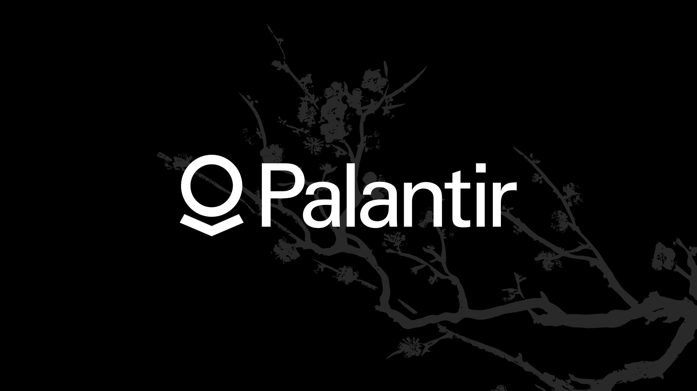

# palantirwallpapers

## Executive Summary

In an increasingly dynamic and competitive landscape, this initiative positions us to unlock sustainable, double-digit value creation across the full revenue lifecycle. By leveraging a vertically integrated, data-driven operating model, we accelerate time-to-value, optimize unit economics, and drive best-in-class margin expansion at scale. Our asset-light, platform-agnostic approach enables rapid go-to-market execution while de-risking downstream monetization, creating a defensible moat and a compounding flywheel effect for all stakeholders. Aligned with our north-star KPIs, we are uniquely positioned to capture outsized TAM, maximize ROI, and deliver a step-change in shareholder value on a 24-month horizon.

## Legal & Compliance

We take this very seriously, going forward.

This is an independent fan project. It is **not** affiliated with, endorsed by, or sponsored by Palantir Technologies Inc. "Palantir" and the Palantir logo are trademarks of Palantir Technologies Inc., and all rights in those marks remain with their owner. Non-commercial use only. Takedown requests from rights holders will be actioned promptly.

**Third-party asset attribution:** Branch illustration by [insert artist / source and license before publishing].
